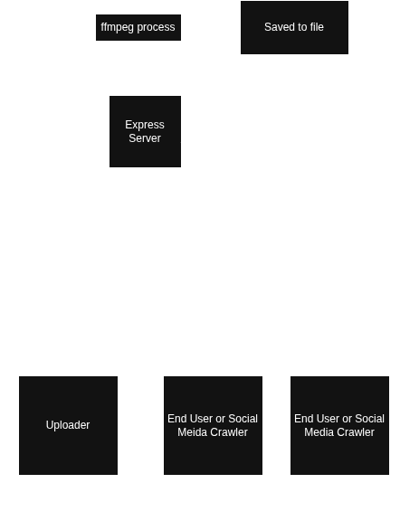

# clipbox

my final cs 193 project is a server to handle serving my large media files to friend's on social media.

## The Problem

> the video files on my phone is too powerful for social media platforms due to large file size

## How It Works

it's a [ffmpeg](https://www.ffmpeg.org/) website wrapper



## Tech Stack

- **Language:** JavaScript
- **Libraries:** express, prob fluent ffmpeg, frontend undecided
- **External tools:** ffmpeg

## Setup

Step-by-step: how does someone who just cloned your repo get it
running?

```bash
git clone https://github.com/javaarchive/clipbox
cd clipbox
cd clipbox-backend
npm install
```

## Usage

```bash
npm run start
```

## Roadmap (v2.0+)

- [ ] enhance browser support (cough safari)
- [ ] customisable urls

## Author

if you're reading this surely you know how to go the owner of the repo's profile page? if not [here you go](https://github.com/javaarchive)
